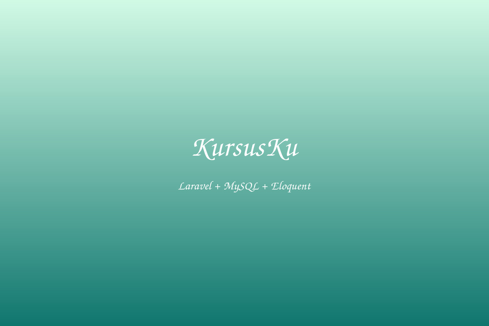
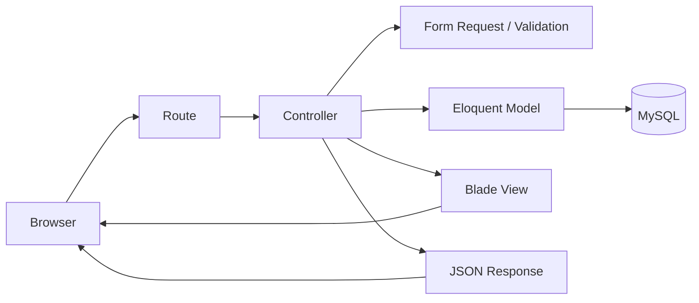
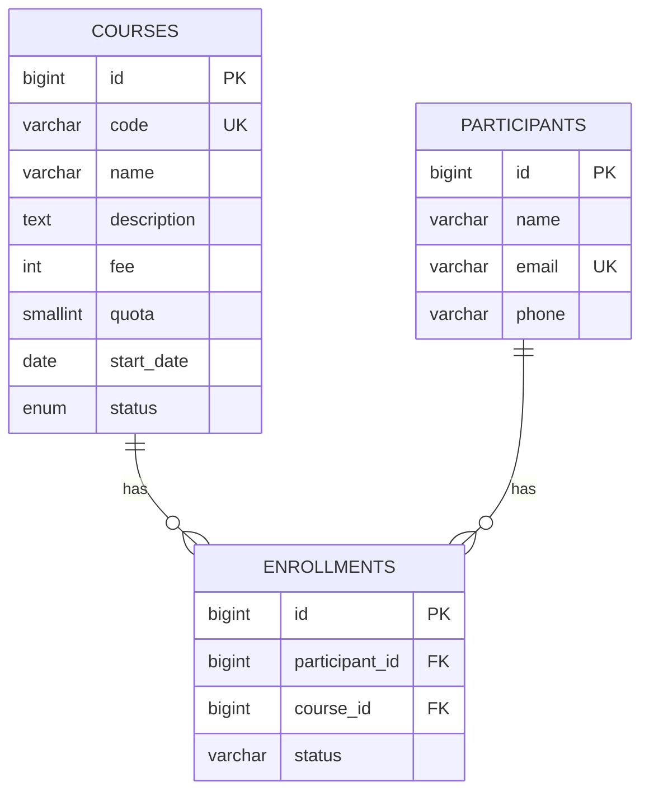

<p align="center">
  
</p>

<h1 align="center">KursusKu — Laravel Learning Project</h1>

<p align="center">
  Aplikasi pembelajaran <strong>Pemrograman Web III (PHP & MySQL)</strong> berbasis Laravel
  untuk mempraktikkan MVC, Blade, database relasional, CRUD, validation, Ajax,
  searching, pagination, testing, dan dokumentasi pengembangan.
</p>

<p align="center">
  
  
  
  
  
  
  
</p>

---

## Tentang Project

**KursusKu** adalah project praktikum yang dikembangkan secara bertahap untuk mata kuliah **Pemrograman Web III / Bahasa Pemrograman III (PHP & MySQL)**.

Repository ini merepresentasikan kondisi aplikasi setelah rangkaian pembelajaran Laravel pada **Pertemuan 7–13**. Fokus utamanya bukan sekadar membuat website yang berjalan, tetapi menunjukkan bagaimana sebuah aplikasi web dibangun secara terstruktur melalui:

- Route dan controller.
- Blade template dan layout reusable.
- Model dan Eloquent ORM.
- Migration dan database MySQL.
- Validation menggunakan Form Request.
- CRUD.
- Relasi antartabel.
- Ajax dan progressive enhancement.
- Search, filter, dan pagination.
- Feature test.
- Dokumentasi evidence.
- AI usage log untuk penggunaan AI secara transparan.

Project menggunakan studi kasus **sistem pengelolaan kursus dan pendaftaran peserta**.

> **Catatan:** versi framework pada repository ini adalah **Laravel 12** dan requirement PHP adalah **PHP 8.3+**, sesuai `composer.json` repository.

---

## Daftar Isi

- [Fitur Utama](#fitur-utama)
- [Tech Stack](#tech-stack)
- [Arsitektur Aplikasi](#arsitektur-aplikasi)
- [Model Data dan ERD](#model-data-dan-erd)
- [Struktur Database](#struktur-database)
- [Route Utama](#route-utama)
- [Struktur Folder](#struktur-folder)
- [Instalasi](#instalasi)
- [Konfigurasi Laragon dan MySQL](#konfigurasi-laragon-dan-mysql)
- [Menjalankan Aplikasi](#menjalankan-aplikasi)
- [Data Seeder](#data-seeder)
- [Testing](#testing)
- [Search, Filter, Pagination, dan Ajax](#search-filter-pagination-dan-ajax)
- [Validation dan Data Integrity](#validation-dan-data-integrity)
- [Security dan Quality Notes](#security-dan-quality-notes)
- [Mapping Pertemuan 7–13](#mapping-pertemuan-713)
- [Dokumentasi Project](#dokumentasi-project)
- [Evidence Praktikum](#evidence-praktikum)
- [AI-Assisted Development](#ai-assisted-development)
- [Troubleshooting](#troubleshooting)
- [Scope dan Batasan Project](#scope-dan-batasan-project)
- [Workflow Git yang Disarankan](#workflow-git-yang-disarankan)
- [Checklist Project](#checklist-project)
- [Lisensi](#lisensi)

---

# Fitur Utama

## 1. Dashboard

Halaman beranda menampilkan:

- Total Course.
- Total Course berstatus `open`.
- Total Participant.
- Total Enrollment.
- Maksimal 6 featured Course berstatus `open`.

Data disiapkan oleh `HomeController` dan dibaca langsung dari database.

## 2. Course CRUD Lengkap

Modul **Course** mendukung:

- List Course.
- Tambah Course.
- Detail Course.
- Edit Course.
- Update Course.
- Delete Course.

Field Course:

| Field | Keterangan |
|---|---|
| `code` | Kode course, unik |
| `name` | Nama course |
| `description` | Deskripsi |
| `fee` | Biaya |
| `quota` | Kuota |
| `start_date` | Tanggal mulai |
| `status` | `draft`, `open`, `closed` |

## 3. Validation

Course memakai:

```text
StoreCourseRequest
UpdateCourseRequest
```

Aturan utama:

- `code` wajib dan unik.
- `name` minimal 3 karakter.
- `fee` minimal 0.
- `quota` antara 1–500.
- `start_date` harus berupa tanggal.
- `status` hanya `draft`, `open`, atau `closed`.

Saat update, kode course yang sedang digunakan record tersebut tetap diperbolehkan.

## 4. Relasi Participant–Course–Enrollment

Tiga entitas utama:

```text
Course
Participant
Enrollment
```

`Enrollment` menjadi tabel penghubung antara Participant dan Course.

## 5. Pencegahan Enrollment Ganda

Database memakai composite unique:

```text
(participant_id, course_id)
```

Satu participant tidak dapat mendaftar dua kali pada course yang sama.

## 6. Availability JSON

Endpoint:

```text
GET /courses/{course}/availability
```

Contoh response:

```json
{
  "course": "Laravel Fundamental",
  "remaining": 24,
  "quota": 25,
  "registered": 1,
  "status": "open"
}
```

Rumus:

```text
remaining = quota - jumlah enrollment
```

## 7. Search, Filter, dan Pagination

Search Course berdasarkan:

```text
code
name
```

Contoh:

```text
/courses?q=Laravel
```

Filter status:

```text
/courses?status=open
```

Gabungan:

```text
/courses?q=Laravel&status=open
```

Pagination:

```php
paginate(10)->withQueryString();
```

## 8. Progressive Enhancement dengan Ajax

Jika JavaScript aktif:

- Live search.
- Debounce sekitar 300 ms.
- Filter tanpa full reload.
- Ajax pagination.
- Partial Blade response.

Jika JavaScript tidak aktif, form GET biasa tetap dapat digunakan.

---

# Tech Stack

| Teknologi | Versi / Peran |
|---|---|
| PHP | `^8.3` |
| Laravel | `^12.0` |
| MySQL | Database utama |
| Laragon | Local development environment |
| Composer | PHP dependency manager |
| Blade | Template engine |
| Eloquent ORM | Database interaction |
| Bootstrap | `^5.3.8` |
| jQuery | `^3.7.1` |
| Vite | `^7.0.0` |
| PHPUnit | `^11.5` |
| Git / GitHub | Version control dan evidence |

---

# Arsitektur Aplikasi



Alur sederhananya:

```text
Browser
   ↓
Route
   ↓
Controller
   ↓
Validation / Business Logic
   ↓
Eloquent Model
   ↓
MySQL
   ↓
Blade View / JSON Response
   ↓
Browser
```

Controller utama:

```text
HomeController
CourseController
EnrollmentController
```

Model utama:

```text
Course
Participant
Enrollment
```

---

# Model Data dan ERD



Konsep relasi:

```text
Course (1) --------< Enrollment >-------- (1) Participant
```

## Relasi Eloquent

### Course

```text
hasMany Enrollment
belongsToMany Participant
```

### Participant

```text
hasMany Enrollment
belongsToMany Course
```

### Enrollment

```text
belongsTo Participant
belongsTo Course
```

Laporan enrollment memakai eager loading:

```php
Enrollment::with(['participant', 'course'])
```

---

# Struktur Database

## `courses`

```text
id
code
name
description
fee
quota
start_date
status
created_at
updated_at
```

`code` memiliki unique constraint.

Status:

```text
draft
open
closed
```

## `participants`

```text
id
name
email
phone
created_at
updated_at
```

`email` bersifat unique.

## `enrollments`

```text
id
participant_id
course_id
status
created_at
updated_at
```

Foreign key:

```text
participant_id -> participants.id
course_id      -> courses.id
```

Kedua foreign key menggunakan `cascadeOnDelete()`.

Composite unique:

```php
$table->unique(['participant_id', 'course_id']);
```

---

# Route Utama

## Dashboard

| Method | URL | Route Name | Fungsi |
|---|---|---|---|
| GET | `/` | `home` | Dashboard |

## Course

| Method | URL | Route Name | Fungsi |
|---|---|---|---|
| GET | `/courses` | `courses.index` | Daftar Course |
| GET | `/courses/create` | `courses.create` | Form tambah |
| POST | `/courses` | `courses.store` | Simpan |
| GET | `/courses/{course}` | `courses.show` | Detail |
| GET | `/courses/{course}/edit` | `courses.edit` | Form edit |
| PUT/PATCH | `/courses/{course}` | `courses.update` | Update |
| DELETE | `/courses/{course}` | `courses.destroy` | Hapus |

## Availability

| Method | URL | Route Name |
|---|---|---|
| GET | `/courses/{course}/availability` | `courses.availability` |

## Enrollment

| Method | URL | Route Name | Fungsi |
|---|---|---|---|
| GET | `/enrollments` | `enrollments.index` | Laporan enrollment |
| GET | `/enrollments/create` | `enrollments.create` | Form enrollment |
| POST | `/enrollments` | `enrollments.store` | Simpan enrollment |

Alias:

```text
GET /pendaftaran
```

akan redirect ke `enrollments.create`.

---

# Struktur Folder

```text
kursusku-laravel/
│
├── app/
│   ├── Http/
│   │   ├── Controllers/
│   │   │   ├── CourseController.php
│   │   │   ├── EnrollmentController.php
│   │   │   └── HomeController.php
│   │   └── Requests/
│   │       ├── StoreCourseRequest.php
│   │       └── UpdateCourseRequest.php
│   └── Models/
│       ├── Course.php
│       ├── Enrollment.php
│       └── Participant.php
│
├── database/
│   ├── create-database.sql
│   ├── migrations/
│   └── seeders/DatabaseSeeder.php
│
├── docs/
│   ├── AI-USAGE-LOG.md
│   ├── ARTICLE-DRAFT.md
│   ├── ERD.md
│   ├── GITHUB-UPLOAD.md
│   ├── IMPLEMENTATION-MAP.md
│   ├── MVC-FLOW.md
│   ├── TEST-MATRIX.md
│   └── UPGRADE-NOTES.md
│
├── evidence/
│   └── week-xx/
│
├── public/
│   ├── css/style.css
│   └── images/hero-kursus.jpg
│
├── resources/
│   ├── css/app.css
│   ├── js/app.js
│   └── views/
│       ├── courses/
│       ├── enrollments/
│       ├── layouts/
│       ├── partials/
│       └── home.blade.php
│
├── routes/web.php
├── scripts/source-check.php
├── tests/Feature/
├── .env.example
├── composer.json
├── package.json
├── phpunit.xml
└── vite.config.js
```

---

# Instalasi

## 1. Clone

```bash
git clone https://github.com/ihdyrtg/kursusku-laravel.git
cd kursusku-laravel
```

## 2. Install Dependency PHP

```bash
composer install
```

## 3. Buat `.env`

Windows Command Prompt:

```bat
copy .env.example .env
```

PowerShell:

```powershell
Copy-Item .env.example .env
```

Git Bash / Linux / macOS:

```bash
cp .env.example .env
```

## 4. Generate Key

```bash
php artisan key:generate
```

---

# Konfigurasi Laragon dan MySQL

Pastikan MySQL pada Laragon aktif.

Repository menyediakan:

```text
database/create-database.sql
```

untuk membuat database `kursusku` dengan `utf8mb4`.

`.env.example` repository belum memuat blok database, jadi tambahkan:

```env
DB_CONNECTION=mysql
DB_HOST=127.0.0.1
DB_PORT=3306
DB_DATABASE=kursusku
DB_USERNAME=root
DB_PASSWORD=
```

Sesuaikan username/password dengan konfigurasi MySQL komputer masing-masing.

> Jangan commit `.env`.

---

# Migration dan Seeder

Jalankan migration:

```bash
php artisan migrate
```

Isi dummy data:

```bash
php artisan db:seed
```

Untuk reset development database:

```bash
php artisan migrate:fresh --seed
```

> `migrate:fresh` menghapus tabel yang ada. Gunakan hanya pada database praktikum/development.

---

# Frontend Dependency

```bash
npm install
npm run dev
```

Production build:

```bash
npm run build
```

---

# Menjalankan Aplikasi

Terminal baru:

```bash
php artisan serve
```

Buka alamat yang ditampilkan Artisan, umumnya:

```text
http://127.0.0.1:8000
```

Jika project diletakkan pada folder `www` Laragon dan auto virtual host dikonfigurasi, project juga dapat dijalankan melalui local domain Laragon.

---

# Quick Start

```bash
git clone https://github.com/ihdyrtg/kursusku-laravel.git
cd kursusku-laravel
composer install
copy .env.example .env
php artisan key:generate
```

Tambahkan `DB_*` ke `.env`, lalu:

```bash
php artisan migrate:fresh --seed
npm install
npm run dev
```

Terminal kedua:

```bash
php artisan serve
```

---

# Data Seeder

Seeder menyediakan:

```text
24 Course
5 Participant
4 Enrollment awal
```

Contoh Course:

```text
WEB-01  Web Dasar
PHP-01  PHP Dasar
LAR-01  Laravel Fundamental
LAR-02  Laravel CRUD
DB-01   MySQL Dasar
SEC-01  Web Security Dasar
TST-01  Testing Laravel
```

Participant menggunakan email dummy domain `.test`.

---

# Testing

Folder test:

```text
tests/Feature/
```

Test class:

```text
CourseCrudTest.php
EnrollmentTest.php
SearchPaginationTest.php
```

Saat ini terdapat **6 test method** pada ketiga class tersebut.

Jalankan:

```bash
php artisan test
```

atau:

```bash
vendor/bin/phpunit
```

## Cakupan Automated Test

### Course CRUD

- Create.
- Show.
- Duplicate code validation.
- Update dengan code yang sama.
- Delete.

### Enrollment

- Simpan enrollment.
- Tolak duplicate enrollment.
- Availability JSON.
- Remaining seat.
- Cascade Course → Enrollment.

### Search dan Pagination

- Search.
- Status filter.
- Pagination.
- Partial response.

## Manual Test Matrix

`docs/TEST-MATRIX.md` memuat **20 skenario** dari dashboard hingga Ajax pagination.

---

# Search, Filter, Pagination, dan Ajax

Search dilakukan melalui query parameter `q`, filter melalui `status`.

Controller mempertahankan query string saat pagination menggunakan:

```php
paginate(10)->withQueryString();
```

Ajax menambahkan:

```text
partial=1
```

sehingga controller dapat mengembalikan partial Blade:

```php
return view('courses._results', compact('courses'));
```

Live search memakai debounce sekitar 300 ms.

---

# Validation dan Data Integrity

Project memakai beberapa lapisan perlindungan:

```text
Browser / Form
       ↓
Laravel Validation
       ↓
Model $fillable
       ↓
Database Constraint
```

### Unique Course Code

Application:

```php
'unique:courses,code'
```

Database:

```php
$table->string('code', 20)->unique();
```

### Duplicate Enrollment

Application:

```php
Rule::unique('enrollments')
```

Database:

```php
$table->unique(['participant_id', 'course_id']);
```

---

# Security dan Quality Notes

## CSRF

Form state-changing harus menggunakan:

```blade
@csrf
```

## Mass Assignment

Model memakai:

```php
protected $fillable = [...];
```

## Query Binding

Search/filter dibangun melalui Eloquent Query Builder, bukan raw SQL concatenation dari input user.

## XSS Output

Gunakan Blade escaping:

```blade
{{ $value }}
```

Hindari unescaped output untuk data tidak tepercaya:

```blade
{!! $value !!}
```

## N+1

Enrollment report menggunakan:

```php
Enrollment::with(['participant', 'course'])
```

## Foreign Key dan Cascade

Foreign key menjaga referential integrity. Penghapusan Course menghapus Enrollment terkait, tetapi Participant tetap ada.

---

# Mapping Pertemuan 7–13

## Pertemuan 7 — Laravel MVC

- `routes/web.php`
- `HomeController`
- `home.blade.php`
- public asset
- named route

Alur:

```text
Browser → Route → Controller → Eloquent/Data → Blade → HTML
```

## Pertemuan 8 — ETS / UTS

Pertemuan evaluasi, tidak menambah milestone Laravel utama.

## Pertemuan 9 — Layout, Bootstrap, jQuery, Ajax

- master layout
- reusable navbar
- Bootstrap via Vite
- jQuery
- Ajax availability
- CSRF

## Pertemuan 10 — Database dan CRUD I

- Course migration
- Course model
- index
- create
- store

## Pertemuan 11 — CRUD II

- show
- validation
- edit
- update
- delete
- Form Request

## Pertemuan 12 — Relational Core

- Course
- Participant
- Enrollment
- foreign key
- composite unique
- Eloquent relation
- eager loading
- cascade delete

## Pertemuan 13 — Data Discovery

- search
- status filter
- pagination
- `withQueryString()`
- partial Blade
- live Ajax search
- debounce
- Ajax pagination
- dashboard statistics
- draft artikel

---

# Dokumentasi Project

| File | Fungsi |
|---|---|
| `docs/IMPLEMENTATION-MAP.md` | Peta implementasi Pertemuan 7–13 |
| `docs/MVC-FLOW.md` | Ringkasan MVC |
| `docs/ERD.md` | ERD relasional |
| `docs/TEST-MATRIX.md` | Manual test matrix |
| `docs/AI-USAGE-LOG.md` | Log penggunaan AI |
| `docs/ARTICLE-DRAFT.md` | Draft artikel ilmiah |
| `docs/UPGRADE-NOTES.md` | Keputusan integrasi |
| `docs/GITHUB-UPLOAD.md` | Panduan upload GitHub |

---

# Evidence Praktikum

Repository menyediakan folder `evidence/` untuk bukti mingguan, antara lain:

```text
week-02
week-03
week-04
week-05
week-06
week-07
week-09
week-10
week-11
week-12
week-13
```

Format evidence dapat dikembangkan menjadi:

```text
evidence/week-xx/
├── README.md
├── screenshot/
├── test-result/
├── reflection.md
└── ai-log.md
```

---

# AI-Assisted Development

Repository menyediakan:

```text
docs/AI-USAGE-LOG.md
```

AI diposisikan sebagai:

```text
pair programmer
reviewer
debugging assistant
test assistant
```

bukan pengganti pemahaman mahasiswa.

Format log:

| Tanggal | Prompt / Masalah | Saran AI | Diterima / Ditolak | Alasan | Test |
|---|---|---|---|---|---|

Mahasiswa tetap harus mampu menjelaskan route, controller, validation, relation, query, Blade, Ajax, dan hasil test.

## Workflow Vibe Coding yang Disarankan

```text
1. Jelaskan konteks
2. Tentukan tujuan kecil
3. Nyatakan constraint
4. Inspeksi kode terkait
5. Buat rencana
6. Lakukan perubahan kecil
7. Baca diff
8. Jalankan test
9. Review security
10. Catat keputusan pada AI usage log
```

Contoh prompt:

```text
Context:
Project Laravel 12 KursusKu.

Goal:
Tambahkan filter Course berdasarkan status.

Constraints:
- Jangan mengubah schema.
- Gunakan Eloquent.
- Pagination harus tetap bekerja.
- Query string harus dipertahankan.
- GET search harus tetap menjadi fallback.

Sebelum coding:
1. Periksa CourseController dan courses/index.blade.php.
2. Jelaskan rencana.
3. Jangan mengubah file yang tidak relevan.

Setelah coding:
1. Jelaskan diff.
2. Berikan test case.
3. Periksa validation dan query binding.
```

---

# Source Check

Repository menyediakan:

```text
scripts/source-check.php
```

Jalankan:

```bash
php scripts/source-check.php
```

Script memeriksa beberapa komponen fundamental seperti route, HomeController, Blade view, public CSS, image asset, named route, dan data `$featured`.

---

# Troubleshooting

## `No application encryption key has been specified`

```bash
php artisan key:generate
```

## `Unknown database 'kursusku'`

Buat database terlebih dahulu melalui `database/create-database.sql`.

## `SQLSTATE[HY000] [2002] Connection refused`

Periksa:

- MySQL Laragon sudah aktif.
- `DB_HOST`.
- `DB_PORT`.
- Username/password.

## `Vite manifest not found`

```bash
npm install
npm run dev
```

atau:

```bash
npm run build
```

## `419 Page Expired`

Pastikan form POST/PUT/PATCH/DELETE memakai:

```blade
@csrf
```

## Course code ditolak

`code` memang unique. Gunakan kode yang belum dipakai.

## Enrollment ditolak

Participant dan Course yang sama tidak boleh didaftarkan dua kali.

## Course tidak muncul pada form enrollment

Form hanya menampilkan Course dengan:

```text
status = open
```

---

# Scope dan Batasan Project

## Sudah tersedia

- Dashboard.
- Course CRUD lengkap.
- Course validation.
- Participant model.
- Enrollment index/create/store.
- Relational database.
- Search.
- Filter.
- Pagination.
- Ajax availability.
- Live search Ajax.
- Automated feature tests.
- Manual test matrix.
- Dokumentasi.
- AI usage log.

## Belum menjadi scope utama

- Authentication/login.
- Role dan permission.
- CRUD Participant lengkap.
- CRUD Enrollment lengkap.
- Payment gateway.
- Email notification.
- File upload.
- REST API lengkap.
- Deployment production.
- CI/CD GitHub Actions.
- Browser/E2E automated test.

---

# Workflow Git yang Disarankan

Clone:

```bash
git clone https://github.com/ihdyrtg/kursusku-laravel.git
```

Buat branch fitur:

```bash
git switch -c feature/nama-fitur
```

Contoh:

```bash
git switch -c feature/participant-crud
```

Commit:

```bash
git status
git add .
git commit -m "feat: add participant CRUD"
```

Push:

```bash
git push -u origin feature/participant-crud
```

Jangan commit:

```text
.env
vendor/
node_modules/
public/build/
```

---

# Checklist Project

## Setup

- [ ] PHP 8.3+ tersedia.
- [ ] Composer tersedia.
- [ ] Node.js dan npm tersedia.
- [ ] MySQL aktif.
- [ ] `.env` dibuat.
- [ ] `APP_KEY` dibuat.
- [ ] Database `kursusku` tersedia.
- [ ] Migration berhasil.
- [ ] Seeder berhasil.
- [ ] Vite berjalan.

## Course

- [ ] Index tampil.
- [ ] Create berhasil.
- [ ] Validation bekerja.
- [ ] Show bekerja.
- [ ] Update bekerja.
- [ ] Delete bekerja.
- [ ] Search bekerja.
- [ ] Filter bekerja.
- [ ] Pagination bekerja.

## Enrollment

- [ ] Participant tampil.
- [ ] Hanya Course open yang tampil.
- [ ] Enrollment dapat dibuat.
- [ ] Duplicate enrollment ditolak.
- [ ] Availability JSON bekerja.
- [ ] Report memakai eager loading.

## Quality

- [ ] `php artisan test` dijalankan.
- [ ] Manual test matrix ditinjau.
- [ ] CSRF diperiksa.
- [ ] Blade escaping diperiksa.
- [ ] Mass assignment diperiksa.
- [ ] Query binding diperiksa.
- [ ] N+1 diperiksa.
- [ ] AI usage log diperbarui.

---

# Prinsip Pembelajaran

Repository ini mempertahankan beberapa prinsip:

1. **SQL dan relasi tetap harus dipahami.** Eloquent mempermudah akses data, tetapi tidak menggantikan pemahaman primary key, foreign key, unique constraint, one-to-many, many-to-many, dan cascade.
2. **JavaScript adalah enhancement.** Search/filter tetap memiliki baseline HTTP GET.
3. **Validation bukan satu-satunya perlindungan.** Integritas data juga dijaga dengan database constraint.
4. **AI tidak menggantikan code ownership.** Mahasiswa tetap bertanggung jawab atas setiap perubahan yang masuk repository.

---

# Repository

GitHub:

```text
https://github.com/ihdyrtg/kursusku-laravel
```

Clone:

```bash
git clone https://github.com/ihdyrtg/kursusku-laravel.git
```

---

# Lisensi

`composer.json` mendeklarasikan lisensi:

```text
MIT
```

Jika repository akan digunakan di luar konteks pembelajaran, sebaiknya tambahkan file `LICENSE` yang konsisten dengan deklarasi tersebut.

---

## Penutup

KursusKu dirancang sebagai **learning repository**, bukan sekadar aplikasi demo.

Alur pembelajaran utamanya:

```text
PHP fundamental
       ↓
Laravel MVC
       ↓
Blade & Layout
       ↓
Database & CRUD
       ↓
Validation
       ↓
Relational Data
       ↓
Search & Pagination
       ↓
Ajax
       ↓
Testing
       ↓
Review & Documentation
```

Mahasiswa diharapkan tidak hanya mampu mengatakan:

> “Aplikasinya berhasil berjalan.”

Tetapi juga mampu menjelaskan:

> “Mengapa aplikasi bekerja, bagaimana data bergerak, bagaimana error ditangani, bagaimana keamanan dasar dijaga, dan bagaimana fitur tersebut diuji.”
